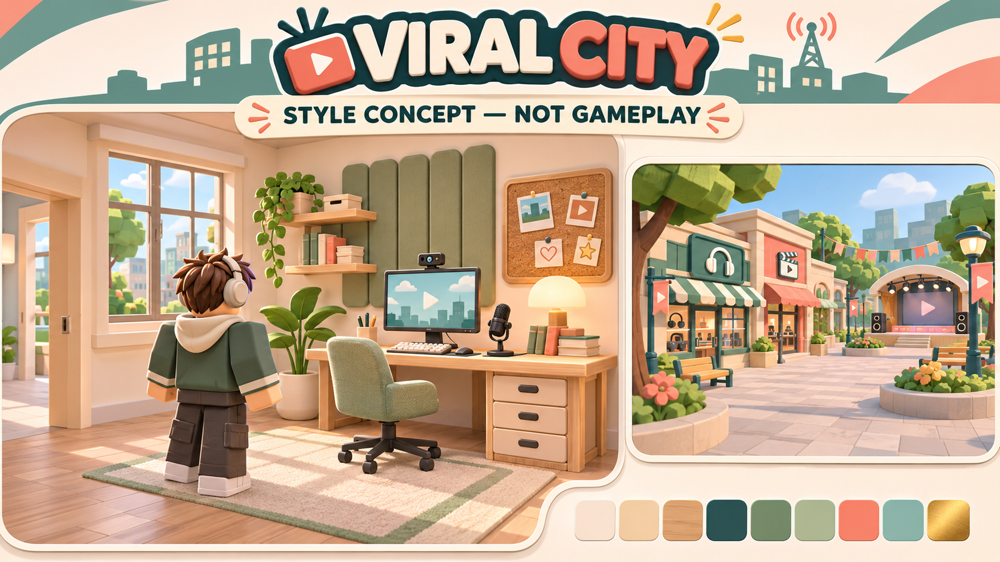

# Viral City — visual direction

**Approved by the owner in chat, 4 November 2026:** continue with the warm daylight concept below. This pass builds on PR #2, baseline `eca81cd1b87920a74a7e49d6d89ffba5199f9628`. No new economic or social mechanic is introduced.

## The creator neighborhood

A small, welcoming pedestrian quarter. Cream masonry, sage storefronts, oak furnishings, coral awnings, generous daylight and legible silhouettes. The initial studio is modest but cared for: a real desk, chair, monitor, keyboard, desk microphone, webcam, plant, shelving, acoustic panels and a framed window. Progress comes from added components and increasingly capable equipment, not glowing color swaps.

The concept is an AI-generated direction reference, **not an engine screenshot or a promise of photorealistic material detail**. Production geometry is original, modular Roblox geometry generated from the repository; custom mesh uploads are not required. Keep the blocky avatar readable and leave the camera/entry lanes open.

## Shared tokens

| Role | Hex | Use |
| --- | --- | --- |
| Cream | `F6EDDC` | walls, light panels, warm readable surfaces |
| Oak | `CB9C6B` | desks, slats, benches |
| Ink | `203E43` | text, frames, equipment casing |
| Sage | `87A68B` | acoustic panels, greenery, storefronts |
| Coral | `ED846D` | LIVE, selected actions, awnings |
| Turquoise | `65B9AC` | success, progress, navigational accents |
| Gold | `E9BC62` | money and rare-recording accents |
| Soft blue | `A9CCD1` | sky/window reflection, screen backplates |

Use SmoothPlastic for clean frames/equipment, Wood for furniture, Fabric for chair/acoustics, Concrete for paving and plaster. Neon is limited to thin status/screen accents. Avoid glass stacks and full-wall luminous materials. Rounded/cylindrical components soften silhouettes; dimensional trims, recesses and layered frames do the work of detail.

Typography: Gotham family, bold numbers/headings, compact uppercase category labels and mixed-case descriptions. Text must remain readable over every surface; dark ink on cream and white on ink. Rarity always includes a name and symbol, never color alone. Monetary/subscriber/view rewards have separate labels.

## Composition and progression

- Plaza: gear storefront and live directory beside a compact stage; paths lead to rows of numbered creator houses. Repeated window/awning modules unify the street. Benches and planters sit outside movement paths.
- Studio: workspace on the back wall, rug and chair in front, shelf and acoustic panels above. Front remains open to the camera; visitors land on the clear side of the rug. No decor overlaps the arena or anchored avatar.
- PC 0–3: single modest monitor → tower plus wider monitor → dual monitors and speakers → three-screen creator workstation. Screen content is procedural graphics.
- Microphone 0–3: small desk stand → articulated boom → boom and pop filter → broadcast arm, isolation frame and mixer. A different silhouette at every level.
- Camera/light 0–3: webcam → tripod camera and one soft light → camera with paired softboxes → broadcast camera, key/fill lights and backdrop accents.
- Rarity: Normal, Hot (existing internal Popular), Viral, Legendary. Preserve existing weights/rewards. Reveal is short, skippable by closing, and never delays actions.

## Motion, audio and quality

Animations are brief, with no camera shake or rapid fullscreen flashes. Reward bursts are client-only and bounded; controls stay usable while rewards play. Keep the notification lane separate from challenge headings. Reduced effects disables bursts and decorative motion. Audio is locally adjustable/mutable and uses a small cue vocabulary rather than one universal notification sound.

Low quality uses the same silhouettes and interaction layout, fewer decorative effects and disabled local accent lights. Do not reduce danger visibility or input feedback. Budget targets are measured in the visual report: no uncontrolled emitters, no per-frame creation, bounded transient UI objects and unchanged replication cadence. Shadows are reserved for structural geometry; small decor does not cast shadows or collide.

## Source layout and evidence

- `src/shared/Theme.luau`: shared palette and presentation tokens.
- `src/server/Visuals/`: modular architecture, furnishings and equipment, composed by City.
- `src/client/`: UI, feedback and local quality/audio settings.
- `docs/art/`: concept and exact prompt/provenance; excluded from the runtime place.
- `tests/visual/`: staged repeatable cameras and a 30-second rendering probe; **not gameplay acceptance** and never published.
- `docs/evidence/visual-before/`, `visual-after/`: engine screenshots at matching camera transforms and viewport presets.

Sound provenance, validation and any platform-owned delivery dependencies are listed in ASSETS.md. Runtime acceptance continues to require the existing 51 checks, two actual Studio clients and the M4 owner gates.
